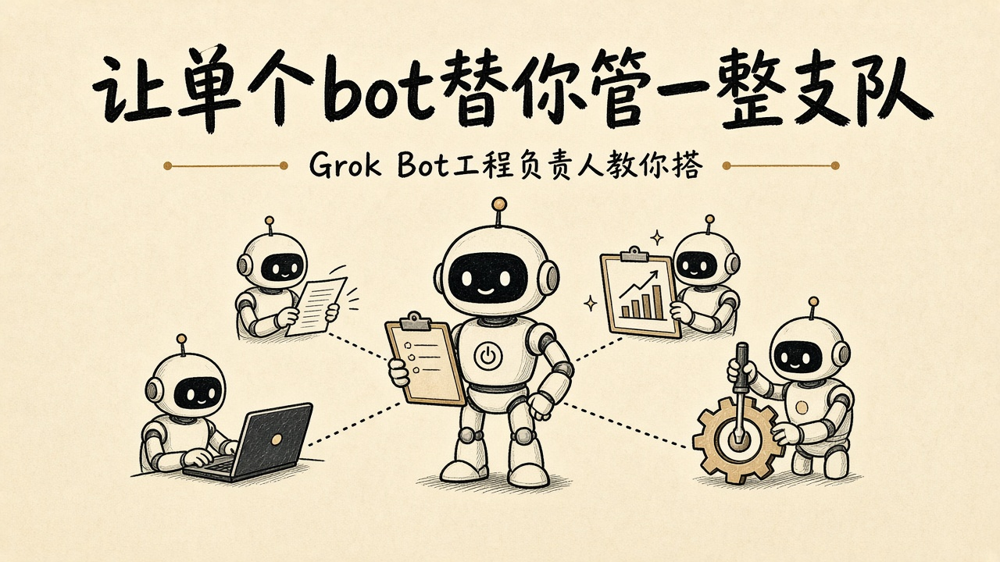
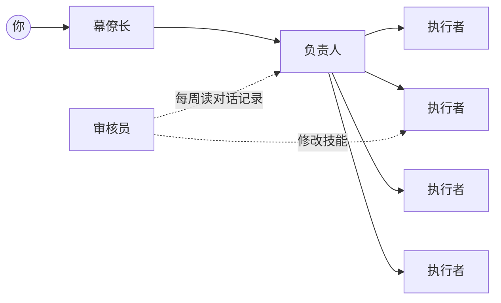
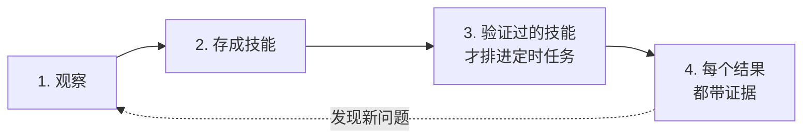

# 案例 01 · 让一个 bot 替你管一整支队




> 好记性不如烂笔头，这篇是《PersonalAgent Playbook》场景手册的实操笔记。

> 最后验证：2026-10-12 ｜ 适用：Grok Bot ｜ 对应场景：00 把 Agent 引入工作、08 团队协作与交接
> 案例人物：Lauren Tan（[@poteto](https://x.com/poteto)），Grok Bot 工程负责人（**利益相关：产品方**）

> [!IMPORTANT]
> **先说清来源。** 本文的核心提示词，是 [0xMorlex](https://x.com/0xMorlex/status/2108905243249434777) 根据 Lauren 的访谈**改写**的，原图底部写着：*"not written or endorsed by her"*。
> 它不是 Lauren 本人写的提示词，也不是她的"标准做法"。文中引用的 Lauren 原话，都单独附了出处。

<!-- TODO：放 0xMorlex 提示词原图 assets/prompt-0xmorlex.jpg（素材待补） -->

---

## 太长不看

Lauren Tan 是 Grok Bot 的工程负责人。0xMorlex 根据她的访谈整理出一套做法，核心只有一句：**你只跟一个 bot 说话，由它替你管一整支 bot 队。**

这支队有四个角色：幕僚长接你的话，负责人拆任务，最多 4 个执行者干活，审核员每周读对话记录、回头改技能。搭建分四步：先观察，再存成技能，验证过的技能才排进定时任务，每个结果都要带证据。

规矩要写死：没人点头，不许花钱、发帖、合并代码；同一件事失败两次，就交回给人。Lauren 自己的 PR 已经按风险分级自动合并，靠的不是胆子大，而是前面的层层验证。新手第一步：先装 Dr Eggbot。

## 一、四个角色：一个 bot 管一整支队

你不用同时跟一堆 bot 说话，只跟一个说就够了。

| 角色 | 做什么 |
|---|---|
| **幕僚长** | 你唯一需要对话的 bot，替你把事情往下交 |
| **负责人** | 接过幕僚长的任务，拆开后分派给执行者 |
| **执行者** | 实际干活的 bot，一次最多 4 个 |
| **审核员** | 每周读一遍对话记录，回头修改技能 |



## 二、照着做的四步



1. **观察**：先看着它做，弄清这件事到底怎么做才算对。
2. **存成技能**：把做对的方法固定下来，下次直接调用。
3. **验证过的技能才排定时**：没验证过的，不让它自己按时跑。
4. **每个结果都带证据**：交回来的东西要附上怎么得出来的，方便你核对。

## 三、规矩写死

> [!WARNING]
> - 没有人点头，**不许花钱、发帖、合并代码**。
> - 同一件事**失败两次，就交回给人**。
> - 没核实的地方，**要主动说出来**。

## 四、Lauren 每天跑的闭环

这是 Lauren 自己公开过的做法[^loop]，从用户反馈一路走到修复上线：

| # | 英文原句 | 中文解释 |
|:---:|---|---|
| 1 | TODO：以 article.md 为准 | 盯着 Slack 里的用户反馈 |
| 2 | TODO | 在 Linear 里建工单 |
| 3 | TODO | 云端编码 agent 复现问题 |
| 4 | TODO | 提交修复，并做 fuzz 测试 |
| 5 | TODO | 在 Slack 里 @ 她；一小时内她没反对，就自动合并 |

她怎么区分哪些任务交给云端 agent、哪些建成 project，见[这条说明](https://x.com/i/status/2107954395979944361)。验证用的技能来自 [pstack](https://github.com/cursor/plugins/tree/main/pstack)，她也[单独介绍过](https://x.com/poteto/status/2082874054483255805)。

## 五、自动合并：不是放手不管

> [!NOTE]
> Lauren 的 PR 早就不是每条都由人来审了。9 月有人问她：**一个月 2500 个 PR**（这是提问者的说法），reviewer 不会累死吗？她只回了一句[^merge]：
>
> *"my agents merge their own PRs, no human reviews."*
>
> 这并不等于放手不管。她后来解释过[^risk]，每个 PR 都会先交给 agent 做代码审查、评估风险，**中低风险的才直接合并**，另外还有 Bugbot 把关。
>
> 她每天跑的那个闭环，最后一步也是这个思路：修复做好了先 @ 她一下，一小时内她没反对，就自动合并。
>
> 能做到这一步，靠的不是胆子大，而是前面那几层：先让 agent 能自己验证，再把犯过的错沉淀成 skill 和 CI 硬规则，最后才敢把合并交出去。

按 Grok Bot 官方的工程指南，这种做法每个月处理的 PR 有 **2000 多个**[^guide]。<!-- 待核对：官方指南原文是否是这个意思 -->

## 六、新手第一步

1. 先安装 [Dr Eggbot](https://x.ai/bot/marketplace/bots/dr-eggbot-v2)。Lauren 介绍过怎么用它来建 bot[^egg]。
2. 再对它说这句话：

```
TODO：以 article.md 第五节的英文提示词原文为准
```

---

## 关于这份 Playbook

这是《PersonalAgent Playbook》场景手册的第一篇实操案例。完整内容在 [GitHub 仓库](https://github.com/zhoumo-creator/PersonalAgent-Playbook)，持续更新，每个判断都附原始出处。

想听 Lauren 讲完整的思路，可以看 [Behind the Craft 的访谈](https://creatoreconomy.so/p/grok-bot-team-14-best-bots-peng-zheng-lauren-tan)。

## 参考来源

访问日期均为 2026-10-12。Lauren Tan 为 Grok Bot 团队成员，以下她的帖子都标**利益相关：产品方**。

- 0xMorlex，原帖与提示词（转述，未经本人认可）：https://x.com/0xMorlex/status/2108905243249434777
- Lauren Tan，用 Dr Eggbot 建 bot（产品方）：https://x.com/poteto/status/2108592835046101383
- Dr Eggbot（Marketplace）：https://x.ai/bot/marketplace/bots/dr-eggbot-v2
- Lauren Tan，cloud agent 和 project 怎么分（产品方）：https://x.com/i/status/2107954395979944361
- pstack 仓库：https://github.com/cursor/plugins/tree/main/pstack
- Lauren Tan，pstack 验证技能（产品方）：https://x.com/poteto/status/2082874054483255805
- Behind the Craft 访谈：https://creatoreconomy.so/p/grok-bot-team-14-best-bots-peng-zheng-lauren-tan
- Lauren Tan 的 X 主页：https://x.com/poteto

[^loop]: Lauren Tan，反馈→修复闭环，X，https://x.com/poteto/status/2107510472601985336 ｜产品方
[^merge]: Lauren Tan，「agents merge their own PRs」，X，https://x.com/poteto/status/2102201638824157449 ｜产品方
[^risk]: Lauren Tan，按风险分级合并的说明，X，https://x.com/poteto/status/2108283057581195413 ｜产品方
[^guide]: xAI，《Grok Bot for Engineering》官方指南，https://x.ai/bot/guides/grok-bot-for-engineering
[^egg]: Lauren Tan，用 Dr Eggbot 建 bot，X，https://x.com/poteto/status/2108592835046101383 ｜产品方

<sub>声明：我目前与文中任何产品都没有合作。广告位待租 :)</sub>

---

[← 返回场景手册](../README.md)
